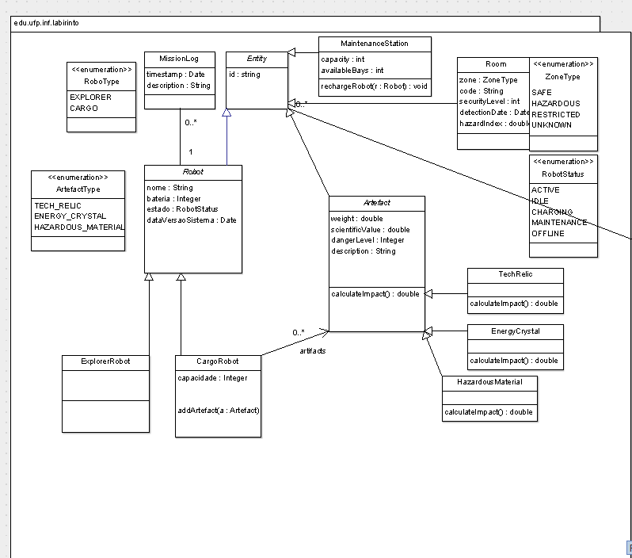
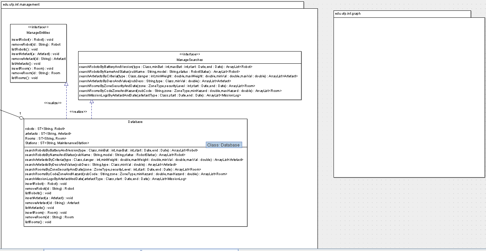

# RoboLabyrinth: Exploration and Collection

Projeto de **Programação Orientada a Objetos** e **Algoritmos e Estruturas de Dados** (Engenharia Informática, Universidade Fernando Pessoa, 2026/27).

Aplicação Java *standalone* que simula um sistema de exploração robótica de labirintos: robôs autónomos recolhem artefactos, passam por salas e usam estações de manutenção. As estruturas de dados vêm da biblioteca [algs4](https://algs4.cs.princeton.edu/home) (Sedgewick e Wayne).

**Grupo**

| Aluno | Número |
|---|---|
| Luis Santos | 2025111261 |
| Rodrigo Pereira | 2025113163 |

**Estado:** Fase 1 (base de dados e API de consulta e gestão de entidades). A Fase 2 (grafo) ainda não foi iniciada.

---

## 1. Estrutura do repositório

```
.
├── src/edu/ufp/inf/
│   ├── labirinto/     # modelo de domínio (entidades) e TestLabirinto
│   └── management/    # Database, interfaces ManageEntities / ManageSearches e TestDatabase
├── uml/               # diagramas de classes (.zargo e PNG)
├── data/              # ficheiros de dados (archive_log.txt é gerado pelos testes)
├── docs/              # documentação Javadoc (HTML)
└── README.md
```

## 2. Como compilar e executar

Requisitos: **JDK 17 ou superior** e o `algs4.jar` (descarregar em <https://algs4.cs.princeton.edu/code/>), colocado em `lib/`.

Executar sempre a partir da **raiz do projeto**, porque o ficheiro de arquivo é escrito em `data/archive_log.txt`.

```bash
# compilar (Linux/macOS)
javac -encoding UTF-8 -cp lib/algs4.jar -d out $(find src -name "*.java")

# executar os testes
java -cp out:lib/algs4.jar edu.ufp.inf.labirinto.TestLabirinto
java -cp out:lib/algs4.jar edu.ufp.inf.management.TestDatabase
```

No Windows, o separador do classpath é `;` (`out;lib/algs4.jar`) e a listagem dos ficheiros `.java` faz-se no IDE ou com `dir /s /b src\*.java`.

Em alternativa, abrir o projeto no IntelliJ IDEA, adicionar `lib/algs4.jar` como biblioteca e executar o `main` de cada classe de teste.

---

## 3. Modelo de domínio (R1)




| Classe | Descrição |
|---|---|
| `Entity` (abstrata) | Base de todas as entidades; tem um `id` único e não mutável. `equals` e `hashCode` usam o id. |
| `Robot` (abstrata) | Nome, bateria (0 a 100), estado, data da versão do sistema e histórico de missões. |
| `ExplorerRobot` | Robot explorador, com alcance dos sensores. |
| `CargoRobot` | Robot de carga: tem capacidade máxima e só aceita artefactos enquanto não a excede. |
| `Artefact` (abstrata) | Peso, valor científico, nível de perigo e descrição; define `calculateImpact()`. |
| `TechRelic`, `EnergyCrystal`, `HazardousMaterial` | Subtipos de artefacto. O impacto é `peso × perigo × fator`, com fator 2, 1.75 e 1.5, respetivamente. |
| `Room` | Sala do labirinto: tipo de zona, código, nível de segurança, data de deteção e índice de perigo. |
| `MaintenanceStation` | Estação com *bays*; recarrega um robot a 100% enquanto houver bays livres. |
| `MissionLog` | Registo de um evento de um robot, com data e (opcionalmente) um artefacto. |
| `Date` | Data (dia, mês, ano), validada na criação e ordenável (`Comparable`). |
| `RobotStatus`, `ZoneType`, `ArtefactType`, `RoboType` | Enumerados. |

O polimorfismo aparece no `calculateImpact()` (cada artefacto calcula o seu impacto) e nas pesquisas, que filtram por `Class` com `isInstance`.

---

## 4. Estruturas de dados e algoritmos

A classe `Database` guarda todas as entidades em **duas camadas**: uma tabela de símbolos principal por entidade (R2) e várias árvores red-black como índices ordenados (R3).

### 4.1 Tabelas de símbolos (R2)

Cada tipo de entidade tem uma `SeparateChainingHashST<String, Entidade>`, com o `id` como chave. Não é preciso ordenar as chaves, e o *hashing* dá acesso em tempo constante.

| Operação | Método | Custo médio |
|---|---|---|
| Inserir | `insertRobot`, `insertArtefact`, `insertRoom`, `insertStation` | O(1) |
| Remover | `removeRobot`, `removeArtefact`, `removeRoom`, `removeStation` | O(1) |
| Editar | `editRobot`, `editArtefact`, `editRoom`, `editStation` | O(1) |
| Listar | `listRobots`, `listArtefacts`, `listRooms`, `listStations` | O(n) |

Os `insert` lançam `IllegalArgumentException` se a entidade for `null` ou se o id já existir (em vez de substituir em silêncio). Os `remove` devolvem `null` se o id não existir e os `edit` devolvem `false`.

A listagem **não segue nenhuma ordem** (nem a de inserção), porque a posição depende do `hashCode` da chave.

### 4.2 Árvores red-black (R3)

Para pesquisas por intervalo usam-se `RedBlackBST<K, ArrayList<V>>`. Várias entidades podem ter a mesma chave (por exemplo, dois robots com 80% de bateria), por isso cada chave guarda uma **lista** de entidades.

| Árvore | Chave | Valores |
|---|---|---|
| `robotsByBattery` | bateria | robots |
| `robotsByVersionDate` | data da versão do sistema | robots |
| `artefactsByValue` | valor científico | artefactos |
| `artefactsByWeight` | peso | artefactos |
| `roomsByDetectionDate` | data de deteção | salas |
| `missionLogsByDate` | data do registo | logs de missão |

Custos (n = chaves na árvore, m = chaves dentro do intervalo):

- inserir, remover e procurar uma chave: **O(log n)**, porque a árvore é balanceada;
- pesquisa por intervalo (`keys(lo, hi)`): **O(log n + m)**.

### 4.3 Pesquisas (`ManageSearches`)

| Pesquisa | Critérios | Como é feita |
|---|---|---|
| `searchRobotsByBatteryAndVersion` | tipo, intervalo de bateria, intervalo de versão | intervalo na árvore da bateria; filtra tipo e data nos candidatos |
| `searchRobotsByNameAndStatus` | parte do nome, modelo, estado | percorre a ST (O(n)); *substring* sem distinguir maiúsculas; o modelo é uma parte do nome da classe |
| `searchArtefactsByCriteria` | tipo, perigo, intervalo de peso, intervalo de valor | intervalo na árvore do valor; filtra tipo, perigo e peso |
| `searchArtefactsByDescAndValue` | parte da descrição, tipo, valor mínimo | intervalo `[minVal, máximo]` na árvore do valor; filtra descrição e tipo |
| `searchRoomsByZoneSecurityAndDate` | zona, segurança, intervalo de deteção | intervalo na árvore da data; filtra zona e segurança |
| `searchRoomsByCodeZoneAndHazard` | parte do código, zona, intervalo de perigo | percorre a ST (O(n)) |
| `searchMissionLogsByArtefactAndDate` | tipo de artefacto, intervalo de datas | intervalo na árvore das datas; só logs com artefacto |

Convenção dos critérios opcionais: `null` (ou valor negativo nos inteiros de perigo e segurança) significa "qualquer valor".

### 4.4 Consistência e arquivo (R4)

- **Inserir:** a entidade entra na ST e em todas as árvores que a indexam.
- **Editar:** se muda um atributo que é chave de uma árvore (bateria, peso, valor científico, data de deteção), a entidade sai da chave antiga e entra na nova.
- **Remover:** sai da ST e das árvores, e é **arquivada** (ver a seguir). Ao remover um artefacto, retira-se também da carga de qualquer `CargoRobot`.
- **Arquivo:** cada entidade removida é guardada na ST `archivedEntities` (em memória) e acrescentada, com data, ao ficheiro `data/archive_log.txt`. Consultar com `getArchivedEntities()` e `listArchivedEntities()`.
- Os `MissionLog` são registados com `registerMissionLog`, que os junta ao robot e à árvore por data. O robot tem de estar na base de dados.

---

## 5. Testes (R5)

| Classe | Método | O que testa |
|---|---|---|
| `TestLabirinto` | `testR1` | impacto polimórfico dos artefactos, limite de carga, recarga nas estações e comparação de datas |
| `TestDatabase` | `testR1` | tabelas de símbolos: inserir, id duplicado, editar, listar e remover (requisito R2) |
| `TestDatabase` | `testR2` | as 7 pesquisas sobre as árvores red-black (requisito R3) |
| `TestDatabase` | `testR3` | consistência entre estruturas (editar a bateria muda de chave na árvore), remoção em cascata e arquivo (requisito R4) |

Cada teste cria o seu próprio contexto e escreve os resultados na consola. Exemplo, a edição de um robot e a sua reindexação na árvore da bateria:

```
Antes da edição (bateria 80..100): 1
Após edição (bateria 80..100): 0
Após edição (bateria 0..20): 1
```

> Os métodos de `TestDatabase` ainda têm o nome `testR1`, `testR2` e `testR3`, que não coincide com os requisitos que testam (R2, R3 e R4), como indicado na tabela acima.

---

## 6. Estado dos requisitos (Fase 1)

| Req. | Descrição | Estado |
|---|---|---|
| R1 | Modelo de classes em UML | Feito (`uml/`) |
| R2 | Tabelas de símbolos e API (inserir, remover, editar, listar) | Feito |
| R3 | Árvores red-black e pesquisas | Feito (7 pesquisas) |
| R4 | Consistência entre estruturas e arquivo | Em curso (ver limitações) |
| R5 | Testes com saída na consola | Em curso |
| R6 | Javadoc | Em curso |

### Limitações conhecidas

- Ao remover um robot, os seus registos de missão continuam na árvore `missionLogsByDate`.
- Os métodos `edit...` alteram os campos um a um; se um valor inválido lançar exceção a meio, os campos anteriores já ficaram alterados.
- Os setters públicos (por exemplo `Robot.setBateria`) não atualizam as árvores. Para entidades já registadas, a alteração deve ser feita pelos métodos `edit...` da `Database`.
- A `Date` ainda tem por implementar as diferenças de dias, meses e anos (não usadas por nenhum requisito até agora).

---

## 7. Fase 2 (planeada)

Grafo pesado e dirigido (algs4: `EdgeWeightedDigraph`, `DirectedEdge`) a ligar salas, robots, artefactos e estações, com caminhos mais curtos por vários pesos, subgrafos, conectividade, recomendações de rota, interface gráfica e importação/exportação de dados (texto e binário).

---

## 8. Documentação

O Javadoc (HTML) está em `docs/`; abrir `docs/index.html` no browser. Para o gerar de novo no IntelliJ: *Tools → Generate JavaDoc*, com o âmbito *Private*.
